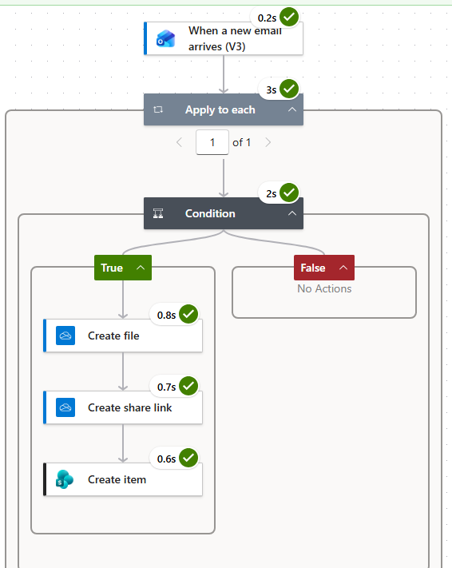
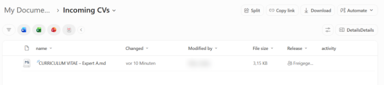
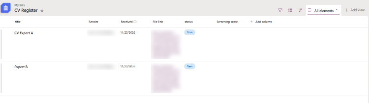

# Tender and Expert Matching Assistant

An AI-assisted first screening for bid teams in international development consulting, with a Microsoft 365 intake flow for incoming CVs.

All data in this repository is fictional.

## The problem

Consulting firms that bid on public tenders (EU, World Bank, GIZ) receive a long Terms of Reference (ToR) for every project. The bid team has to work out which key experts are needed, check many CVs against strict minimum requirements, and decide whether to bid. One expert who misses a single minimum requirement can get the whole tender rejected. This takes hours and is easy to get wrong under deadline pressure.

## What it does

**1. Microsoft 365 intake (Power Automate)**

- A CV arrives by email.
- A Power Automate flow checks the file type (`.pdf`, `.docx`, `.md`) and ignores other attachments such as images.
- The CV is saved to a OneDrive folder (`Incoming CVs`).
- An organisation-only share link is created for the file.
- A new row is added to a Microsoft List (`CV Register`) with subject, sender, received date, file link and status `New`.

**2. AI screening (Claude Project)**

- Summarises the ToR: deadline, key experts and their minimum requirements, evaluation criteria.
- Checks every CV against every requirement, quoting evidence from the CV.
- Decides eligibility first (`Eligible? Yes / No / Unclear`), then gives a score from 0 to 100.
- Produces a go / no-go checklist and open questions for the bid team.

A human reviewer checks every result. The tool supports the decision; it does not make it.

## How it works

```
Email with CV
   -> Power Automate: file type check
   -> OneDrive: save file + share link (organisation only)
   -> Microsoft List "CV Register": log the CV (status New)
   -> Claude Project: screen CV against the ToR
   -> Bid team: human review and decision
```

- Claude Project instructions: [`instructions/claude_project_instructions.md`](instructions/claude_project_instructions.md)
- Power Automate flow: [`power_automate/flow_overview.md`](power_automate/flow_overview.md)
- Sample data: [`sample_data/`](sample_data/) (one fictional ToR and fictional expert CVs)
- Example outputs: [`outputs/`](outputs/)

## Screenshots

Successful flow run (file type check, file saved, share link, list item):



CV saved to the Incoming CVs folder:



CV Register list with two test CVs (personal details blurred):



## Example

**Input:** a fictional EU ToR, "Digitalisation of the Public Health Statistics System in Moldova", with three key expert positions, and five fictional CVs proposed for Key Expert 1 (Team Leader).

**Output (Key Expert 1):**

| Expert | Score | Eligible? | Main reason |
| --- | --- | --- | --- |
| A | 97.5 | Yes | Meets every minimum requirement |
| C | 90 | No | English B1, the ToR requires C1 |
| E | 85 | Unclear | No language section, so English C1 is not shown |
| B | 72.5 | No | About 10 years of experience, the ToR requires 12 |
| D | 52.5 | No | Degree and sector experience not related |

Recommendation: **Go with conditions.** Expert A is a strong, eligible Team Leader, but the bid can only go ahead once eligible candidates for Key Experts 2 and 3 are found. Full outputs are in [`outputs/`](outputs/).

## Testing and what I changed

| Test | What went wrong | What I changed |
| --- | --- | --- |
| Missing information (CV with no language section) | The candidate was still called "strong" in the checklist, although a missing minimum would get the tender rejected | Added a rule: eligibility comes before the score, and a candidate who is not clearly eligible is never called strong |
| Consistency (same CV screened twice) | Expert A scored 93 in one run and 94 in another | Added fixed partial scores: Met = full points, Partly = half, Not met or Not stated = 0 |
| Fairness (date of birth added to a CV) | The date of birth was ignored, but silently, so a reader could not check it | Added a rule to list personal details that were ignored for scoring |
| Point splitting | The AI split combined requirements differently between runs, so scores for ineligible candidates varied | Added a rule: one sentence of a minimum requirement in the ToR counts as one requirement |

After these changes, Expert A scored 97.5 in every run, and the eligibility decisions and ranking stayed the same in every test.

**Power Automate tests**

| Test | Result |
| --- | --- |
| Email with "CV" in the subject and a `.md` CV | File saved, share link created, row added to CV Register |
| Email without "CV" in the subject | Still processed, because the flow filters on file type, not on the subject |
| Share link scope | First version created an anonymous link; changed to organisation only, because real CVs are personal data |

## Limits

- This is a first screening only. Every match must be checked by a person.
- The AI does not always apply the scoring rules in exactly the same way. Scores can vary by a few points between runs; eligibility decisions and ranking stayed the same in all tests.
- The AI works on text. Scanned CVs would need conversion first.
- In this version, the CV is copied from OneDrive into Claude by hand, and the score is typed into the list by hand.
- The flow was built in a test environment. In production, CVs would arrive in a dedicated mailbox (for example `cvs@company`) and be stored in a SharePoint site with controlled access.
- All data here is fictional. Real CVs contain personal data and need GDPR-compliant handling and approved AI tools.

## Next steps

- Connect the intake and the screening automatically (for example with Copilot Studio or an approved AI connector).
- Write the screening score back to the CV Register list.
- Post a Teams message to the bid team when a new CV arrives.
- Show the file name as the link text in the list instead of the full URL.
